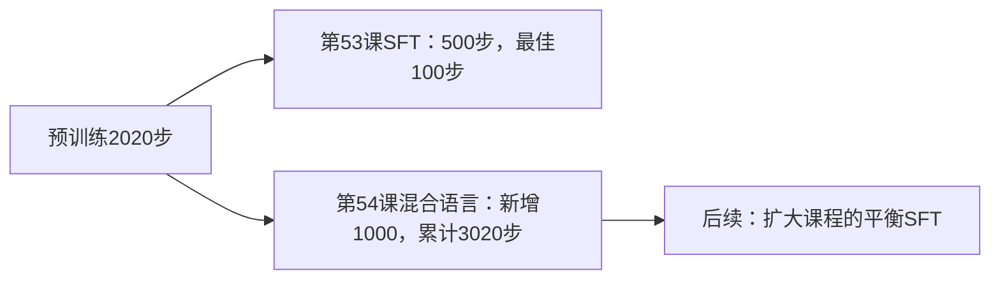

# 第五十四课：扩大可验证中文任务，实际加强基础语言训练

本阶段已完成两条线：生成并核验800条、10类中文任务；为30M基础模型引入此前未显式使用的中文故事和四书训练章节，实际新增1000次预训练更新。预算事先为1000更新或900秒，实际503.77秒结束，累计预训练3020步。没有在旧91组上追加SFT，也没有自动执行新课程的SFT。

## 模型分支先分清



本课从model/lesson50/last_train.pt继续预训练，不从已经过拟合的SFT第500步继续。第53课聊天最佳仍独立保留，chat_sft.py默认路径不变；新的base_fp16.pt是基础语言模型，不是新的聊天微调模型。不能把3020与旧分支500直接累加，声称这份基础模型已经经历了SFT。

## Block 1：扩大任务覆盖，标签怎样算“审核过”

新课程由本项目编写中文模板并生成确定性输入，包含加法、减法、乘法、最大公约数、升序、降序、逐字倒序、汉字计数、保持首现顺序去重、最小最大值，共10类、每类80条，总800条。这里是“助手审阅10个模板和验证规则，全部800个标签经过程序校验”，不是800条经过独立真人或专家审核的开放知识问答。

prepare_chat54.py的build_curriculum负责生成，verify_task负责用原payload和答案做不变量核验：

|任务|生成方法|核验依据|
|---|---|---|
|加减法|整数运算|用逆运算还原操作数|
|乘法|整数乘积|整除及商是否匹配|
|最大公约数|math.gcd|另行枚举公共约数取最大|
|升降序|排序|相邻单调性、全部元素及重数守恒|
|字符倒序|逐码点反转|再次反转恢复原字符串|
|汉字计数|纯汉字字符串长度|逐字检查汉字范围并计数|
|保持顺序去重|首次出现保留|不重复、集合相同、首现位置单调|
|最小最大|极值函数|答案来自输入且包围所有输入值|

验证不只检查“生成器自己算的答案”。CI给十类各造一个格式仍合法但内容错误的标签，要求真实验证器全部拒绝。例如排序答案额外复制一个数字，JSON仍合法，却违反重数守恒。

底层有序输入相同的记录跨题型归为同组，固定种子划分后训练639条/636组、验证161条/159组，两边均覆盖10类。模板在两边共享，因此验证衡量已知模板的新输入，不是未见任务或通用聊天能力。加法交换律、排序输入置换等语义等价情况未全面合并，组数不应被称作等量独立数学知识。

系统提示、角色标记、BPE6400、上下文256和只监督助手目标的规则均保持。新任务先准备好，不在本课预训练中偷换为SFT梯度目标。

## Block 2：旧一般问答与新课程分开登记

data/chat54/sft_catalog.json固定两个组件的文件摘要：

|组件|训练行/组|验证行/组|审核方式|
|---|---|---|---|
|第53课一般问答|117/91|26/23|助手逐项内容审阅，非独立专家标注|
|第54课确定性任务|639/636|161/159|模板审阅及全量标签程序核验|

目录只做精确首问跨集合检查，保留原split和group，不宣称跨来源语义完全去重。后续可按一般问答50%、任务50%，任务内部再平衡10类，避免639行计算题把一般对话淹没；这只是记录好的后续建议，本课未消费新的SFT预算。

## Block 3：基础语言数据不是把错误问答复制更多次

三个语言域使用已有明确训练/验证划分，不打开测试正文：

1. original：第四十八课冻结的通用预训练文本。
2. stories：此前给旧168万参数实验准备的[TinyChineseStories](https://huggingface.co/datasets/joe-chiu/TinyChineseStories/blob/ad789c9d622bfbdeecdc90df2041b3ba458e0368/README.md)，首次显式加入这个30M模型分支。原作者joe-chiu声明为GPT-3.5合成故事、CC-BY-4.0，原提交及来源摘要沿用第45课。
3. novels：用户收集、清洗并按完整章节划分的四书，仅取原训练章节；这是文学语言域，不将小说情节当作已核实事实问答。

旧基础权重的混合数据许可限制仍适用，本次继续限教学研究，不因为故事源有CC-BY-4.0就给整个模型重新声明商业许可。四书的来源由用户提供，本课没有独立作所有版本的许可核验。

训练前先抽查片段，保留失败记录：初版故事样例有诊断、治疗与诅咒混写；第二版又发现故事00469开头损坏和Word count尾注。最终language_v3在模型更新前固定：同一主题规则排除故事训练262条、验证10条，再排除已发现坏开头1条；训练5篇删除生成字数尾注。原始文件和v1/v2审阅记录保留，未使用其初版数组训练。

最终分层抽查4篇故事片段、四本书各1个章节片段，每条仅首100和末100字符。记录明确包括奇幻能力与理想化情节，只批准文学语言用途，不宣称全文事实审核。简繁原文保留，没有做繁简转换。主题正则、字符损坏检查与抽查仍有局限，不是普遍内容正确性的证明。

训练文档还与所有分域验证的规范化64字符采样片段做直接重叠检查，命中则保守排除整篇；本次没有额外命中。这不保证排除所有跨来源语义改写。旧通用验证编码逐字节复现，不改原先的388180目标尺子。

|语言域|训练文档|训练token|验证文档|验证目标|
|---|---:|---:|---:|---:|
|旧通用|9576|3034409|1192|388180|
|中文故事|1538|628270|221|88533|
|四书章节|368|2635671|46|339739|

总训练流6298350 token，其中故事与四书贡献3263941 token，是扩大可用语言覆盖，不代表本阶段已遍历全部这些新token。字数、BPE token数、训练曝光次数必须分开；重复曝光也不应算成独立新知识。

## Block 4：为什么用分域采样

如果直接连接所有文本，文档多或篇幅长的来源会占据大多数窗口。这里每次成功更新取8个256-token窗口：旧通用4、故事3、四书1。每域有独立的轮号、下一窗口偏移及确定性乱序；微批2、累积4，整组按真实目标总数归一，末窗仍用-100屏蔽填充。

原AdamW m/v/t、Scaler及随机状态从预训练2020步恢复；学习率预先调整为0.0001，原来是0.0003。混合语料是新流，所以三个新游标均从0开始，不误用旧单流epoch1/offset4306。此处是持续预训练，但数据和学习率已变，不声称沿原旧数据训练轨迹完全继续。

按分域平均交叉熵计算固定分数：

\[
S=0.5L_{original}+0.375L_{stories}+0.125L_{novels}
\]

每个域内部先按有效token数平均，再用上述预先固定权重相加；不是将三个域所有目标直接混成全局均值。起点、250、500、750、1000新增更新处使用完全相同的验证与权重，不按结果改权重或挑窗口。新任务验证只做开发诊断，不参与本阶段最佳模型选择。

## Block 5：实际完成的训练

|新增更新|累计预训练|旧通用损失|故事损失|四书损失|固定加权分数|
|---:|---:|---:|---:|---:|---:|
|0|2020|4.430704|5.416740|6.387407|5.045055|
|250|2270|4.286017|3.825122|5.421184|4.255077|
|500|2520|4.245910|3.484761|5.218554|4.082060|
|750|2770|4.200721|3.309375|5.084367|3.976922|
|1000|3020|4.164551|3.177842|4.982555|3.896786|

本阶段新增1000次更新、2047573个有效目标，阶段503.77秒，达到更新上限后停止，溢出跳过0。累计预训练曝光6184317目标；最佳与最后都是累计3020步。故事域改善明显，旧通用也改善，未出现仅新域降低、旧域明显退化的情形。

三域曝光分别旧通用1023784、故事767789、四书256000目标。不能直接算1000×8×256=2048000作为真实数，因为尾窗填充不计损失，差427目标。下一游标为旧通用epoch0/offset4000、故事epoch1/offset545、四书epoch0/offset1000。

同一阶段同时改变了语料混合、学习率和微批组织，没有另跑等预算“只用旧数据”对照。因此能说明这一组合阶段在固定验证上改善，不能把全部收益单独归因于某一条清洗规则或增加语料。

800条新任务没有被用于本阶段梯度更新。其161条开发验证、1113个助手目标，在真实前文下损失5.965799→5.442977、逐token准确率13.12%→19.23%；不能由此断言模型已会算术、排序，更不是自由生成的整题正确率或最终测试成绩。

## Block 6：固定续写仍未通过语义验收

实际FP16导出文件的六条固定结果全部在lesson54_analysis.json，原FP32检查点全部输出在lesson54.json。它们可能因FP16舍入改变后续采样路径，不要求逐字相同，也不手动改成一致。

例如导出贪心续写：

> 清晨，小明走进教室，他走到一座大海。他走到一座大海，走到一座大海。他走到一座大海，走到一座大海。他走

> 春风落叶落，秋风拂面，思念如水，思念如水，思念，思念，思念，思念，思

仍有重复、语义跳跃和简繁混合。部分采样解码还含替换字符，可能与生成字节序列或截断有关，原因未完整诊断；没有据此宣称训练文件有乱码，也没有删除该样例。验证在真实前文下预测下一token，续写不断接回模型自己的预测，错误会累积，损失下降不保证句子自然。

所以本课的验收是“数据覆盖扩大、三个语言域固定验证改善、恢复可复现”，不是聊天能力验收。当前默认聊天入口仍加载第53课SFT模型，新基础模型需要后续在扩大且平衡的SFT组件上另行微调。

## Block 7：权重、状态与核验

base_fp16.pt实际60078933字节，不超过1GB；完整best/last均360411963字节，内容SHA相同，可复用一组Release分片。完整格式chat_mix54_train_v1保存三个域游标及实际采样配比，不能用旧单流恢复函数直接猜数据位置。

check_language54_resume.py比较直接恢复与临时保存重载后相同下一步更新，全部参数最大差0，AdamW/Scaler/三域游标一致，正式源文件SHA未变。两次副本核验更新不计正式1000步。CI只在CPU每域复算4窗，共12窗，不能冒充全部三个验证集的CPU复算。

完整报告lesson54.json、恢复证据lesson54_resume.json、生成分析lesson54_analysis.json和分片元数据lesson54_assets.json分开保存。约60MB推理文件放Git，完整状态通过[第五十四课Release](https://github.com/codesknight/playATryModel/releases/tag/lesson54-pretrain-mix-pilot)交付，公开与远端摘要状态以元数据为准。

## 学习者实操

```powershell
& 'D:\apps\anaconda3\envs\vllm-qwen\python.exe' scripts/learn/34_inspect_language_mix.py # 只读检查800条任务标签、三域验证和累计3020步，不追加训练。
```

可单独体验新基础模型续写：

```powershell
& 'D:\apps\anaconda3\envs\vllm-qwen\python.exe' scripts/experiments/generate_chat_pilot.py --model model/lesson54/base_fp16.pt --prompt '清晨，小明走进教室，' --greedy # 真实基础模型续写，尚未进行扩大课程的新SFT。
```

把完整检查输出贴回即可。本课训练已代跑，学习者不必重跑train_language54.py。代码非空行均附注释：先读任务生成与verify_task，再读SCHEDULE、分域游标推进和整组有效目标分母，最后看固定验证权重与最佳选择。

后续直接使用新基础检查点与已登记的扩大任务组件做平衡SFT对照；在那之前保留一般问答和任务的独立统计，不能把新任务条数当成已经训练的模型能力。
